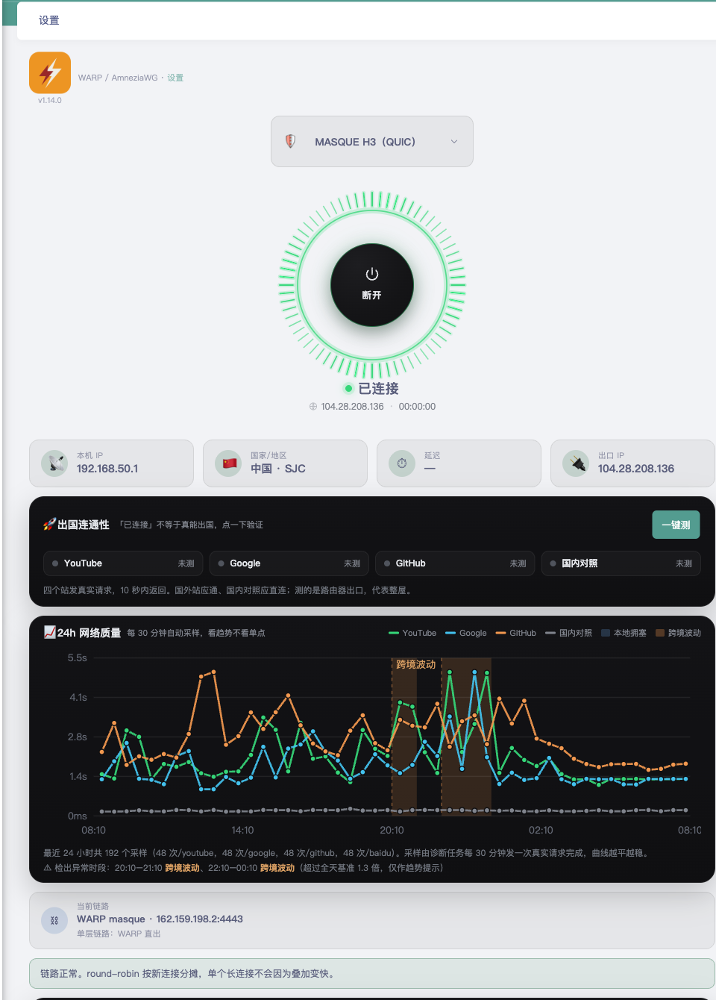
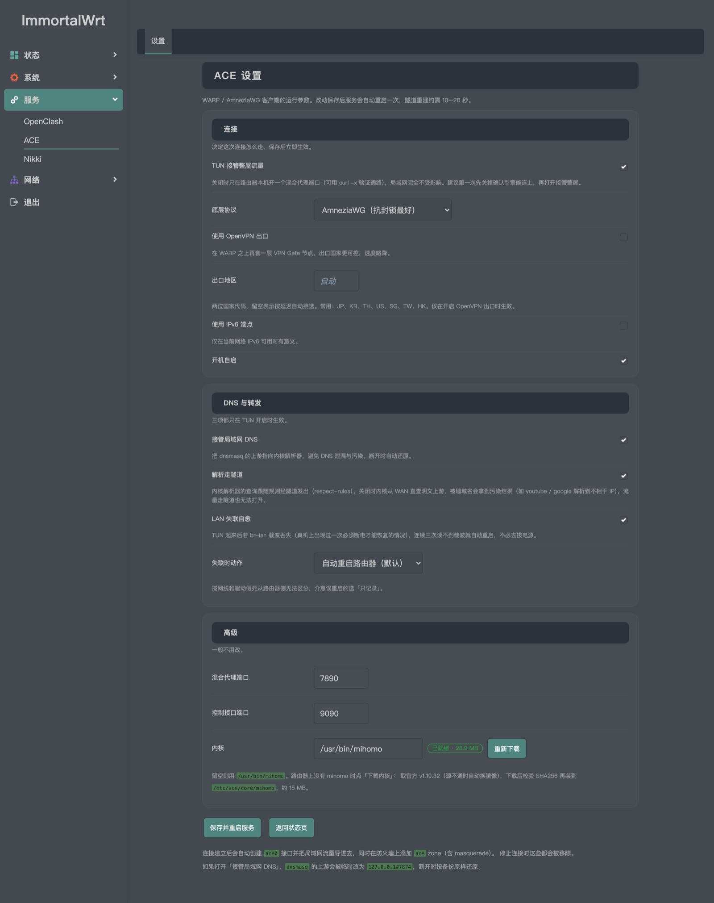
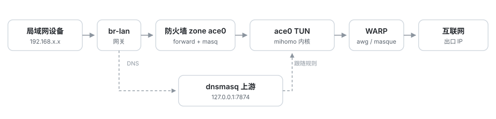

<div align="center">


# ACE for OpenWrt

**把整屋网络装进一台路由器 —— Cloudflare WARP 全屋出口，点一下就连**

[](https://github.com/bluepebblex-dev/openwrt-ace/releases)
[](https://github.com/bluepebblex-dev/openwrt-ace/actions/workflows/ci.yml)
[](LICENSE)
[](https://openwrt.org)
[](#安装)
[](https://github.com/bluepebblex-dev/openwrt-ace/commits/main)

[安装](#安装) · [首次连接](#首次连接两步走) · [界面](#界面) · [视觉](#视觉符号从橙色待命到青绿就绪) · [协议](#支持的协议) · [设计取舍](#设计取舍) · [排障](#排障)

</div>



## 为什么是 ACE

如果你在 OpenWrt 上折腾过代理插件，这几件事多半经历过：

> 装个插件要 SSH 敲十几条命令，缺依赖自己补；配置文件几百行，分流规则看不懂；
> 节点列表要自己找订阅、自己换链接，免费订阅用两天就挂，付费订阅又是一笔月费；
> 更别提来路不明的订阅链接——你不知道流量会经过谁的服务器，也不知道对面在不在记录你。

**ACE 把这些问题一个个拆掉了：**

| 原有插件的痛点 | ACE 的答案 |
|---|---|
| **安装麻烦**：要手动准备内核、补依赖、SSH 命令行伺候 | 两个 ipk 装完即用；内核没有就设置页**一键下载**（官方源 + 镜像自动切换，装前校验 SHA256），复用 nikki/OpenClash 自带的也行 |
| **配置繁琐**：YAML/JSON 几百行，规则组、策略组、DNS 分流都要自己写 | **零配置**。装完打开 LuCI 页面，大圆钮点一下就连——注册 WARP 账号、全量扫描端点并实测延迟与速率、自动挑最优、渲染配置、起 TUN、验数据面，全部自动 |
| **对小白不友好**：出错只会给你一个日志文件 | 连接过程**分阶段可视化**、可中途取消；出问题首页日志区直接给「服务事件」，README 排障表把现象和位置一一对应 |
| **要自己准备订阅**：免费的不稳定，付费的看节点脸色 | **不需要任何订阅**。走 Cloudflare WARP 官方服务，账号由引擎在路由器本地注册，端点池自己扫、自己测、自己挑 |
| **安全隐患**：来路不明的订阅——流量经过第三方中转，可能在被记录、被注入 | 流量直达 **Cloudflare WARP**，中间不经过任何第三方的服务器；无外部面板、无云端控制端，不给路由器多开一个攻击面 |
| **体积大、吃内存**：装完占几百 MB，跑起来内存爆表，老路由器直接卡死 | **轻到可以忽略**。下载包合计 ≈ 5 MB（LuCI 界面包只有 34 KB）；运行时引擎 + 内核常驻 ≈ 100 MB（真机实测），256 MB 内存的设备就能舒适跑满血 |

一句话：**装上、点一下、整屋出国——不需要订阅、不需要配置、不需要懂行。**

### 九个拿得出手的卖点

- **🪶 轻量省内存，低配路由器也跑得动** —— 下载包合计约 5 MB（界面包仅 34 KB），运行时引擎 + 内核常驻约 100 MB，全部真机实测。256 MB 内存的路由器舒适运行，不用为了跑个插件先换设备。
- **🆓 零订阅、零月费** —— 不买节点、不找订阅链接、不看任何人脸色。账号本地注册，端点自己扫自己挑，Cloudflare 官方出口，省下的是每年几百上千的订阅费，省掉的是「流量经过谁」的疑心。
- **🖱️ 小白也能三分钟上手** —— 装 ipk → 打开 LuCI → 点大圆钮，三步完成。没有命令行门槛，没有几百行配置，没有要背的分流规则。会装 OpenWrt 插件的人就会用 ACE。
- **🔥 6 种协议，就地热切换** —— AmneziaWG / WireGuard / WARP-in-WARP / MASQUE(H3) / MASQUE(H2) / MASQUE 嵌套隧道，首页下拉即换，改完立即生效，不用重启不用重装。封锁升级了？换个协议继续用。
- **🛡️ 断网恐惧症终结者** —— 「先验证、后接管」是刻在架构里的：探测阶段根本不存在 TUN，候选失败时局域网完全无感；验证通过才建 `ace0`、改 DNS、加防火墙 zone。*这是真机踩坑换来的设计，README 里写满了事故现场和修复方式。*
- **🩹 会自己照顾自己** —— 探活连续失败自动断开，绝不让路由器挂在「显示已连接、实际不通」；LAN 载波丢失三次自动重启自愈（可关）；断开时按备份还原 dnsmasq、清防火墙、清流表，还原是挂在 `init.d stop` 里**无条件执行**的。
- **🧠 DNS 这块它真的懂** —— 不抢 53 端口：内核解析器听 `127.0.0.1:7874`，dnsmasq 上游指过去，隧道挂了局域网照常解析；防污染模式剔除会被递归污染的公共解析器，只留可信上游经隧道查询。
- **📦 一个 ipk 就是一条龙** —— 引擎纯 Go 无 CGO，构建不需要 OpenWrt SDK；路由器上没有 mihomo 内核？设置页一键下载（官方源 + 镜像自动切换，装前校验 SHA256）。
- **🖥️ 界面不将就** —— LuCI 原生两页（首页 / 设置），与 macOS 桌面端同一套布局语言：大圆钮一键连接、阶段进度、实时速率、出口 IP + 国旗 + Cloudflare 机房，不是那种「能用就行」的配置 dump 页。

## 特性

| | |
|---|---|
| **6 种协议** | AmneziaWG / WireGuard / WARP-in-WARP / MASQUE（H3、H2、嵌套），首页就地切换，改完立即生效 |
| **整屋接管** | `ace0` TUN + 独立防火墙 zone（forward + masq），局域网设备零配置；**先验证后接管**，失败的候选不碰局域网 |
| **DNS 不抢 53** | 内核解析器听 `127.0.0.1:7874`，dnsmasq 上游指过去；隧道挂了局域网照常解析 |
| **防污染** | `dns_leak=1` 时上游只留可信解析器，剔掉会被递归污染的国内解析器 |
| **自愈** | 探活连续三次失败自动断开；`br-lan` 载波丢失自动重启（可关） |
| **24h 质量曲线** | 每 30 分钟四站采样入 SQLite，首页画出 24 小时耗时趋势——尖峰是只升外国线（跨境波动）还是连国内对照一起升（本地 ISP 拥塞），一眼分清 |
| **分流只做一件事** | 「绕过大陆」：出国流量走隧道、国内流量直连；两个分流数据库自动下载自动更新，不提供自定义规则（见下文） |
| **升级保配置** | conffiles + prerm/postinst 备份还原，升级不把 `tun` 打回 0 |
| **内核自举** | 路由器上没有 mihomo 也能用：设置页一键下载（官方源 + 镜像，装前校验 SHA256） |
| **住宅出口** | 可叠一层 VPN Gate 出口换国家（实验，速度取决于免费中继） |
| **界面同构** | 首页 / 设置两页，布局与 macOS 桌面端一致 |

### 分流哲学--化繁为简：只做「绕过大陆」

ACE 的分流只有一条规则：**出国流量走隧道，国内流量直连**。判断依据就是 `geosite.dat` +
`geoip.metadb` 两个官方数据库——连接前缺了自动补下，设置页一键「下载并更新」，除此之外没有任何
规则要你写、要你管。

**不支持自定义分流，我们把它当优点，也不藏着当限制：**

- 对大多数人是优点。自定义规则是代理插件断网、漏流的头号来源：一条规则写错，要么国内网站绕道
  出国变慢，要么该出国的流量直连裸奔。ACE 干脆不给这个出错机会——零规则就是零误配，数据库
  每次更新都跟着上游最新版走，不需要学习成本，也不需要维护成本。
- 对想按应用、按流媒体精细分流的进阶玩家，这是实打实的限制。ACE 没有规则组、策略组、自定义
  GEO 站点，这类需求请直接用 OpenClash / nikki——我们不想假装能做到，然后让你在出问题时
  对着一个不支持的功能干瞪眼。

取舍很简单：ACE 选择把复杂度留在引擎里，而不是搬到你的配置文件里。要「装完就能用、坏了能自愈」，
选 ACE；要「一切尽在掌握」，选别的。

## 安装

从 [Releases](https://github.com/bluepebblex-dev/openwrt-ace/releases) 下载两个包，传到路由器装：

```sh
opkg install ace_*_aarch64_cortex-a53.ipk luci-app-ace_*_all.ipk
```

或者用仓库里的脚本一条命令搞定（自动上传 + 安装 + 重启服务）：

```sh
ACE_SSH_PASS=路由器密码 ./install.sh 192.168.1.1
```

装完打开 **LuCI → 服务 → ACE**（浏览器强刷一次，旧缓存会看不到新界面）。

> 路由器上已经装了 mihomo（nikki / OpenClash 之类通常都会带）就直接复用；没有的话打开设置页点
> 「下载内核」：取官方 v1.19.32（GitHub 不通时自动换镜像），下载后校验 SHA256，装到
> `/etc/ace/core/mihomo`，约 15 MB。

| 包 | 内容 | 依赖 |
|---|---|---|
| `ace` | 引擎二进制、init.d、uci 配置 | `mihomo` 可选（没有时在设置页下载，或复用 nikki 自带的） |
| `luci-app-ace` | LuCI 控制器与页面 | `ace`、`luci-compat` |

> 目前只出 `aarch64_cortex-a53`（mediatek/filogic 等）。其他架构改 `build-ipk.sh` 里的
> `ARCH` 与 `GOARCH` 即可自行构建，引擎本身是纯 Go 无 CGO。

## 首次连接：两步走

**第一次务必先不开 TUN。** `tun` 默认是 `0`，此时服务只起一个本地混合端口，路由器网络毫无影响：

```sh
/etc/init.d/ace start
curl -x http://127.0.0.1:7890 -sI https://www.gstatic.com/generate_204
```

`204` 说明引擎在路由器上能连上出口。确认后再接管整屋：

```sh
uci set ace.main.tun=1 && uci commit ace && /etc/init.d/ace restart
```

这时才会建 `ace0`、改 dnsmasq 上游、加防火墙 zone。这个顺序不是保守，是踩过坑——真机上出现过跑
TUN 之后 LAN 侧设备直接失联、路由器 IP 不可达但 WAN 还活着的状况，只能人工断电。分两步至少保证
出问题只影响这个服务本身。

首次连接会自动注册 WARP 账号、扫端点（1~3 分钟），之后走缓存很快。

## 界面

两个页面，和 macOS 桌面端同一套结构。

**首页** —— 大圆钮一键连接/断开（连接过程显示阶段、可点取消）；协议与出口地区就地切换；信息卡显示
本机 IP / 出口国家（国旗 + Cloudflare 机房）/ 延迟 / 出口 IP；流量卡显示上下行实时速率与本次累计；
下方是运行日志（服务事件 + 引擎输出，可刷新、可清除）。

**24h 网络质量** —— 首页有一张趋势卡：诊断任务每 30 分钟对四个站发一次真实请求并落库（`/etc/ace/diag.db`，
SQLite，自动滚动保留），曲线按「耗时」画四条线——YouTube / Google / GitHub 三条是隧道侧，国内对照（百度）
是直连侧。判读口径和「一键测」一致：曲线整体抬高但国内对照不动，是跨境链路波动（换节点有效）；两条一起抬，
是本地 ISP 拥塞（加带宽才有效）。单点状态会骗人，趋势不会。

**设置页** —— 连接方式、TUN 接管、DNS 接管 / 防泄漏、LAN 失联自愈等运行参数，保存后服务自动重启
（隧道重建约 10~20 秒）。

### 视觉符号：从橙色待命到青绿就绪

ACE 把「还没连」「正在绕行」「已经就绪」做成一套颜色语言：橙色是待命与告警，青绿是链路建立后的
确认。下面三条循环动画是首页的视觉基调——它们是概念动画，不是抓包或测速画面，用来让状态一眼可读。

| 星盘启动 · 待命 → 链路点亮 | 数据绕行 · 风险区 → 青绿节点 | 速度成形 · 橙色光轨 → 青绿护盾 |
|---|---|---|
|  |  |  |

<details>
<summary>设置页截图</summary>



</details>

## 支持的协议

| 协议 | 说明 |
|---|---|
| `awg` | AmneziaWG，抗封锁最好（默认） |
| `wg` | WireGuard，更快 |
| `wwarp` | WARP-in-WARP，双层 wg/awg 链式 |
| `masque` | MASQUE，CONNECT-IP over HTTP/3/QUIC |
| `masque-h2` | MASQUE，CONNECT-IP over HTTP/2/TCP |
| `masque-mm` | MASQUE-in-MASQUE，嵌套隧道 |

> 端点由引擎自动挑选（扫描缓存 6 小时内复用）。MASQUE 系没有「端点池」的概念，走 Cloudflare 固定 anycast。

### OpenVPN 出口（实验）

在 WARP 之上再叠一层 VPN Gate 住宅出口，用来把最终出口国家换成「真实家宽 IP」，
而不是 Cloudflare 的数据中心 IP。开启后出口形如 `60.93.146.33`（日本家宽）。

三点需要先知道：

- **需要较新的内核。** mihomo v1.19.12 接受全部 WARP 协议，但拒绝 `type: openvpn`
  出站，连接会以「握手失败」的样子失败。v1.19.32 起才支持。设置页在打开开关时会
  直接告诉你当前内核行不行，不行就点「下载内核」——下载版会被自动优先使用。
- **速度取决于免费中继。** 实测同一台路由器：纯 WARP 约 460 KB/s，叠加 VPN Gate 后
  在 20–150 KB/s 之间波动，且中继可能几十分钟内失效。适合「要一个特定国家的住宅
  IP」，不适合当日常出口。
- **仍然可以一键关掉。** 出口验证通过才接管 TUN，失败时局域网完全不受影响。

## 配置项

`/etc/config/ace`，也可以直接在设置页改。

| 键 | 默认 | 说明 |
|---|---|---|
| `enabled` | `0` | 随系统启动 |
| `proto` | `awg` | 底层协议，见上表 |
| `tun` | `0` | 是否 TUN 接管整屋流量 |
| `dns_takeover` | `1` | 把 dnsmasq 上游指向内核解析器（仅 `tun=1`） |
| `dns_leak` | `1` | 内核解析器跟随规则走隧道，并剔除国内解析器（仅 `tun=1`） |
| `lan_watchdog` | `1` | `br-lan` 载波丢失三次后自愈 |
| `watchdog_action` | `reboot` | 自愈动作：`reboot` / `none`（只记日志） |
| `openvpn` | `0` | 在 WARP 上再叠一层 VPN Gate 出口 |
| `openvpn_region` | 空 | 两位国家代码，空 = 按延迟自动挑 |
| `pick` | 空 | 固定出口端点 `ip:port`，空 = 引擎自动挑最优 |
| `mixed_port` | `7890` | 本地混合代理端口（旁路调试用） |
| `ipv6` | `0` | 使用 IPv6 端点池 |
| `core` | 空 | 内核路径，空 = `/usr/bin/mihomo`；也可留空让引擎用 `/etc/ace/core/mihomo` |

## 设计取舍

**为什么先验证再接管。** 早期版本内核一起来就带 TUN + `auto-route`，然后才开始验证
隧道通不通。这意味着每个失败的候选都是一段全屋断网窗口，而 `-hold` 会自动重试，
窗口连成一片；用户点「停止」也停不掉，因为看守进程会重建会话。现在分两步：

1. 探测阶段的配置里**没有 tun 段**，只有 mixed 端口。候选失败时局域网完全不知道
   发生过什么（无设备、无路由、不改 DNS）。
2. 验证通过后才停掉探测实例、用完整 TUN 配置起第二个实例，等 `ace0` 真的出现、
   经 mixed 端口再跑一次往返，才算接管。接管失败就回滚。

清理也分两层：`init.d stop` 无条件回收 guard / 内核 / `ace0` / `lookup 2022` 的策略
路由并还原 dnsmasq；引擎侧只在**本会话确实接管过**（`state.TUN`）时删设备——
`ace0` 是固定名字，无条件删会让一个调试用的纯代理实例把正在服务的隧道拆掉。

**为什么不是另写一套路由逻辑。** 引擎本身就是完整的客户端：注册 WARP 账号、扫端点、挑最优、渲染
mihomo 配置、起内核、验数据面、守护会话。移植只需要补 Linux 侧的差异，不需要重写。



**TUN 而不是 TPROXY。** 引擎渲染的 mihomo 配置本来就带 `tun.auto-route + auto-detect-interface +
dns-hijack`，在 Linux 上是原生的；改用 TPROXY 要重做一整套 nft 规则，收益不明。

**DNS 不抢 53。** macOS 用 53 是因为系统解析器只能填 IP；路由器上 53 是 dnsmasq 的。内核改听
`127.0.0.1:7874`，再把 dnsmasq 上游指过去——隧道挂掉时局域网照常解析，不会整屋断网。

**DNS 防污染（`dns_leak=1`）。** 即使 DNS 查询跟随规则走隧道，国内公共解析器自身的递归查询仍会被
污染，而且 mihomo 并行竞速取最快的应答——污染结果稳定获胜。所以开启泄漏保护时，上游只保留可信
解析器（1.1.1.1 / 1.0.0.1，经隧道查询），国内域名策略与代理服务器解析保留完整列表。

**防火墙用 zone，不用 include。** fw4 的 include 塞进 chain 会和它自己的规则顺序打架；独立 zone
（`device ace0` + `masq 1`）是唯一同时解决 forward 放行与 SNAT 的地方。

**三层安全网**（都是踩坑后加的）：

1. `route-exclude-address` 排除 `192.168/10/172.16` —— 局域网流量永不进隧道；
2. 就绪后连续三次探活失败则自动断开，不让路由器挂在「显示已连接、实际不通」的状态；
3. 断开时按备份还原 dnsmasq、删掉 zone、`conntrack -F` 清流表。

**LAN 失联自愈（`lan_watchdog`）。** TUN 起来并探活通过后启一个看门狗，每 20 秒读一次
`/sys/class/net/br-lan/carrier`：曾经通过、之后连续三次读不到载波，就 `logger` 记一笔再 `reboot`
——替人拔电源。只在「通 → 断」时触发，开机没插网线不会乱重启；介意误重启可以设 `none`。

**升级保配置。** conffiles 声明 + prerm/postinst 备份还原双保险，opkg 升级不会把用户改过的
`/etc/config/ace` 打回默认值（曾真机实测 `tun=1` 被覆盖归零、整屋静默回到裸 WAN，故修）。

## 验证

只看到出口 IP 对**不算验证通过**——那只能证明「有这么个 IP」，证明不了「家里设备的流量真的穿过了
路由器隧道」。三步全过才算。

**① 流量确实穿 `ace0`（硬证据）**

```sh
cat /sys/class/net/ace0/statistics/rx_bytes /sys/class/net/ace0/statistics/tx_bytes
# —— 让家里某台设备访问一次外网（curl https://www.qq.com 之类）——
cat /sys/class/net/ace0/statistics/rx_bytes /sys/class/net/ace0/statistics/tx_bytes
```

计数器明显上涨说明 LAN 流量走了隧道。`conntrack -L` 里查不到局域网源 IP 是**正常的**：转发后源地址
被 masquerade 改写成 `ace0` 的 IP，且短连接很快回收，所以看计数器比翻连接表可靠。

**② 排除「其实是设备自己在跑隧道」（防假阳性）**

在被测的局域网设备上确认它自己没有独立隧道：默认路由指向路由器（不是本机某 utun）；没有本机
`mihomo` / WARP / ACE 进程；没有激活的 VPN 配置（如 macOS `scutil --nc list`）。任一条不满足，
出口 IP 就可能来自设备自己的隧道。

**③ 真实站点可达（不是只看状态码）**

```sh
curl -sL https://www.youtube.com | grep -oE '<title>[^<]*</title>' | head -1
curl -sL https://github.com     | grep -oE '<title>[^<]*</title>' | head -1
curl -sL https://www.google.com | grep -oE '<title>[^<]*</title>' | head -1
```

三个都返回真实 `<title>` 即通过。Google 首页可能 302 到 `google.com.hk`（WARP 出口被 Google 判为
HK），跟到 `.com.hk` 拿到 200 + 标题即正常，不是故障。

## 排障

| 现象 | 位置 |
|---|---|
| 提示「未检测到 mihomo 内核」 | 设置页点「下载内核」；或指定现成内核 `uci set ace.main.core=/usr/bin/mihomo` |
| 连不上、卡在扫描 | `tail -f /var/log/ace.log`，或在首页日志区看「服务事件」 |
| 内核起不来 | `/etc/ace/core/core.log` |
| 出口 IP 对但怀疑没走隧道 | 看 `ace0` 计数器是否增长（验证①），并确认设备自身无隧道（②） |
| Google 302 / 落到 .com.hk | 正常，WARP 出口被 Google 判为 HK 的 geo 重定向，跟到 200 即可 |
| 提示「当前 Core 不支持 OpenVPN 出站配置」 | 内核太旧（需 ≥1.19.32）：设置页「下载内核」，引擎会自动优先用下载版 |
| 开了 OpenVPN 后很慢 | 免费中继的常态。看首页「出口 IP」是否已变成住宅地址；不能忍就关掉开关 |
| 端口被占 | 日志会写明 `端口 7890 被 xxx (pid N) 占用` |
| DNS 不解析 | `uci show dhcp.@dnsmasq[0]`、`netstat -ln \| grep 7874` |
| 想彻底恢复 | `/etc/init.d/ace stop`，再 `uci set dhcp.@dnsmasq[0].noresolv=0` |
| init.d 动作挂死 | 查 flock 泄漏：`for d in /proc/[0-9]*/fd/1000; do readlink $d; done`，后台子进程继承 procd 锁 fd 会把它占成永久 |

**应急**：若某个版本导致 LAN 不可达，串口 / SSH 里 `/etc/init.d/ace stop` 即可；最坏情况断电重启，
服务不会自启，路由器回到干净状态。

## 与 macOS 版的差异

| | macOS | OpenWrt |
|---|---|---|
| 流量接管 | utun + 系统解析器 | `ace0` + dnsmasq 上游 |
| 系统代理 | 不设置（TUN 全接管） | 不涉及 |
| DNS 端口 | 127.0.0.1:53 | 127.0.0.1:7874 |
| 界面 | Swift 原生窗口 | LuCI 页面（首页 / 设置，同构布局） |
| 生命周期 | GUI 持有 | procd 看护 |
| 端点缓存 | settings.json | `/etc/ace/cache.json`（引擎共用，TTL 6 小时） |

## 构建

需要 Go 1.21+ 与 python3（打 ipk 用），引擎在仓库内，克隆即可构建，不需要 OpenWrt SDK：

```sh
./build-ipk.sh              # 默认 aarch64_cortex-a53
VER=1.2.1 ./build-ipk.sh    # 指定版本号
```

产物在 `dist/`，`-ldflags "-s -w"` 后引擎约 13.5 MB，ipk 约 5 MB。

## 目录结构

```
openwrt-ace/
├── build-ipk.sh              # 不依赖 OpenWrt SDK 直接产出 ipk
├── install.sh                # 上传 + 安装到路由器
├── docs/                     # README 用 logo、截图与概念动画
│   ├── logo.png              # 项目 logo（ACE × Polaris）
│   ├── screenshots/          # LuCI 真机截图、架构图
│   └── demo/                 # 三条状态概念 GIF（Muse 生成）
├── engine/                   # Go 引擎（WARP 注册、端点扫描、mihomo 渲染、会话守护）
└── files/
    ├── etc/config/ace        # uci 配置
    ├── etc/init.d/ace        # procd 服务封装
    └── usr/
        ├── share/ace/run.sh  # uci → 命令行
        ├── share/rpcd/acl.d/ # LuCI ACL
        └── lib/lua/luci/     # 控制器 + 首页/设置页面
```

<div align="center">

**powered by ACE ♥️ & Polaris** ✨

</div>

## License

MIT。引擎部分源自上游开源实现，路由器侧的服务封装、LuCI 界面与打包脚本为本仓库所有。
